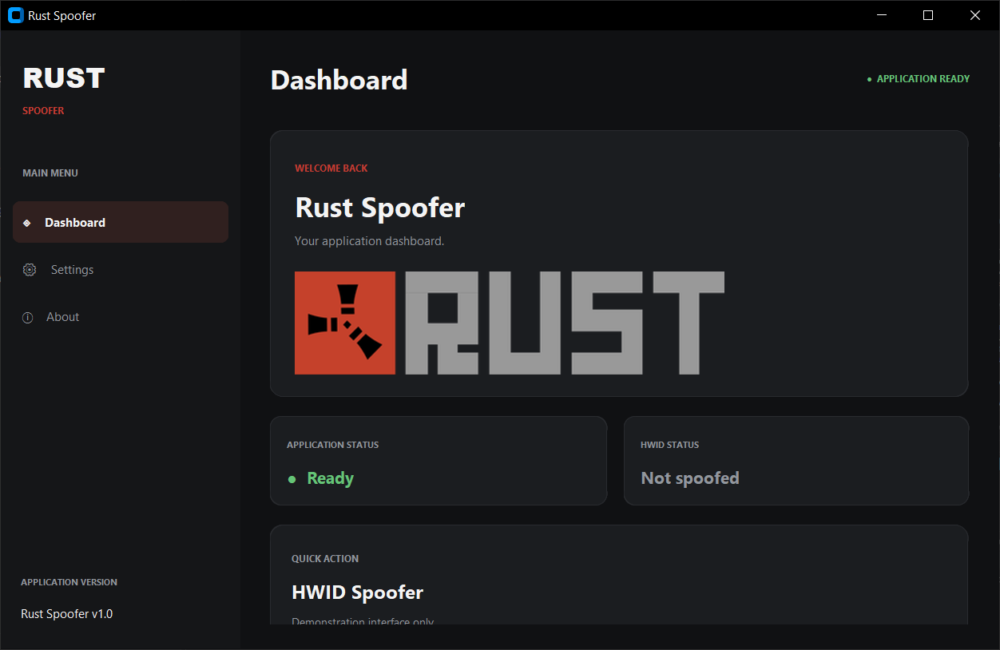

# Rust Spoofer UI

A modern Rust-themed desktop utility interface built with Python and CustomTkinter.

## Preview



## Features

- Modern dark-themed interface
- Rust-inspired visual design
- Custom application dashboard
- Application status display
- HWID status indicator
- Interactive demonstration button
- Responsive window layout
- Native Windows window controls

## Built With

- Python 3
- CustomTkinter
- Pillow

## Installation

**1. Clone the repository**

```bash
git clone https://github.com/YOUR_USERNAME/rust-spoofer-ui.git
```

**2. Navigate to the project directory**

```bash
cd rust-spoofer-ui
```

**3. Install dependencies**

```bash
pip install -r requirements.txt
```

**4. Run the application**

```bash
python main.py
```

## Project Structure

```text
rust-spoofer-ui/
│
├── main.py
├── rust_logo.png
├── requirements.txt
├── README.md
├── .gitignore
│
└── assets/
    └── screenshot.png
```

## Disclaimer

This project is a visual UI demonstration.

The HWID functionality is simulated and does not perform actual hardware identification modification, system changes, or game-ban bypass operations.

Rust is a trademark of Facepunch Studios. This is an independent fan-made project and is not affiliated with or endorsed by Facepunch Studios.

## License

No license has been granted at this time. All rights reserved unless otherwise stated.
